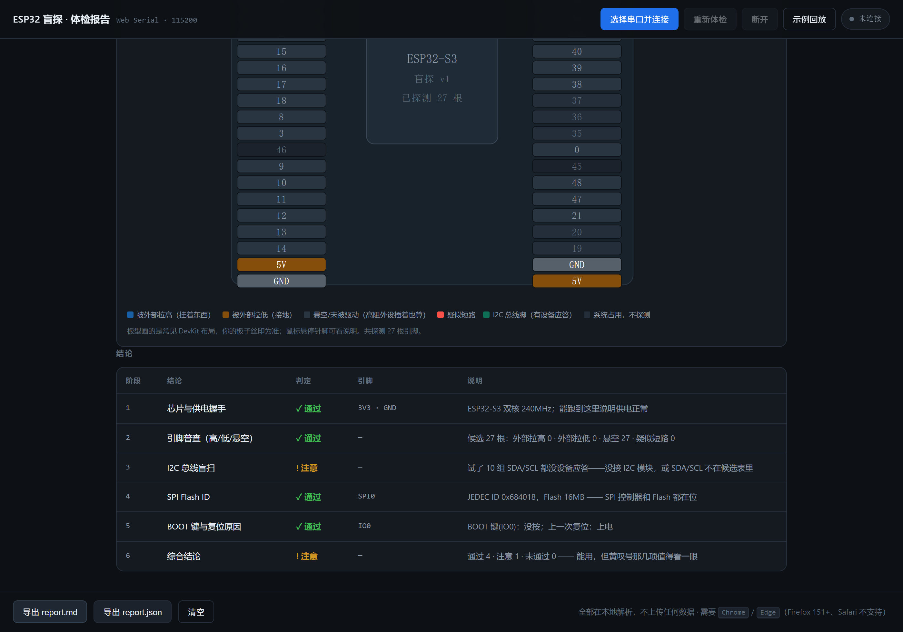

# esp32-blind-probe

给 ESP32 新手的**「量线」工具 + 体检报告页**。

不猜你插的是什么模块（型号千万种，猜不完），只回答三个问题：

1. **每根候选引脚**是高、是低、还是悬空？（有没有东西挂着）
2. **I2C 总线上**有没有设备应答？（报地址，型号自己查）
3. **SPI Flash** 能不能读出 ID？（板子和 SPI 是不是活的）

固件跑完输出六行 `##RESULT` JSON，网页串口控制台把它们变成一份看得懂的六阶段报告，外加一张**引脚图**：两排针脚逐个上色（悬空/被拉高/被拉低/疑似短路），I2C 脚高亮，鼠标悬停看说明。不用装任何驱动工具，浏览器点一下就能跑。



## 仓库结构

```
firmware/blind-probe/blind-probe.ino   固件（Arduino，ESP32 core 3.x）
index.html                             网页控制台（单文件，无框架无构建）
protocol.md                            串口输出协议（含可直接抄的 emit() 封装）
```

## 使用

**第一步 · 烧固件**

1. Arduino IDE 装 ESP32 core，板子选你的型号（默认针脚表针对 **ESP32-S3**）
2. 打开 `firmware/blind-probe/blind-probe.ino` → 编译上传
3. 串口监视器 115200，看到 `=== ESP32 盲探 v1 ===` 就是跑起来了；**发送字母 `r` 可重跑一次**

**第二步 · 看报告**

1. 用 **Chrome / Edge** 打开 `index.html`（GitHub Pages 或本地双击都行）
2. 点 **「选择串口并连接」**，选你的板子
3. 六张阶段卡自动点亮，底部 **「导出 report.md / report.json」** 可以存档或发群里求助

## 六个阶段

| # | 阶段 | 检什么 | 判定逻辑 |
|---|---|---|---|
| 1 | 芯片与供电握手 | 型号 / 主频 / Flash / PSRAM | 能跑到这里 = 供电正常 |
| 2 | 引脚普查 | 每根候选脚：外部拉高 / 拉低 / 悬空 / 强拉低 | 出现"强拉低"→ 黄叹号（疑似接反或短路） |
| 3 | I2C 盲扫 | 轮询 10 组常见 SDA/SCL，报出应答地址 | 一个设备都没有 → 黄叹号 |
| 4 | SPI Flash ID | 读 JEDEC ID | 读不出 → 红叉 |
| 5 | BOOT 键与复位原因 | IO0 电平 + 上次复位原因 | 欠压复位会额外提示 |
| 6 | 综合结论 | 汇总前五阶段 | 有红叉→红；有黄→黄 |

**引脚怎么判断的**（阶段 2）：每根脚读三次——悬空读、开内部上拉读、开内部下拉读。
跟上拉走=悬空；上拉下拉都读到高=被外部拉高；都读到低=被外部拉低；开了上拉还是低=强拉低。

## 局限（很重要，先看这段）

这工具量的是「**这根线现在有没有被外部驱动或被低阻拉住**」，**不是**「这根线上有没有插东西」。所以：

| 看到的结果 | 可能是什么 | 是不是故障 |
|---|---|---|
| 悬空（灰） | ① 真的没接线 ② **插着高阻输入型外设**（屏的 SCK/CS/DC、按键） | ❌ 不算故障 |
| 被外部拉低（橙） | ① **模块自带下拉电阻**（很多 TFT 模块有 10k 下拉）② 真接到了 GND ③ 线短路 | ②③ 才是问题 |
| 被外部拉高（蓝） | ① 模块带上拉（I2C 常见 4.7k）② 接在 VCC 上 | 一般正常 |
| I2C 扫不到设备 | ① 真没接 ② SDA/SCL 不在候选组合里 ③ 线松了 | ②③ 才是问题 |

**换句话说**：它擅长回答「哪几根线在被人拽着」，不擅长回答「这根线连着哪个模块」。想确认某根线物理通不通，还是万用表蜂鸣档最可靠。

**判断故障的可靠信号**：同一组线里**只有一根**异常（比如 SCK 橙、CS/DC 全灰），更可能是模块自带特性；**成组异常**或者 **I2C 明明插着却扫不到**，才值得动手查线。

## 换板子怎么改

固件顶部两张表，改完重烧即可：

```cpp
static const uint8_t PROBE_PINS[] = { ... };      // 候选引脚
static const uint8_t I2C_PAIRS[][2] = { ... };    // 要盲扫的 SDA/SCL 组合
```

默认表针对 ESP32-S3，已避开：GPIO19/20（USB）、GPIO26~37（Flash/PSRAM）、GPIO43/44（UART0 日志口）。

## 浏览器支持

| 浏览器 | 支持 |
|---|---|
| Chrome / Edge（桌面） | ✅ |
| Firefox 151+ | ✅ |
| Safari | ❌（不支持 Web Serial） |

> Web Serial 需要 `https://` 或 `localhost` 环境——GitHub Pages 天然满足；本地双击 `file://` 打开 Chrome 也放行。
>
> 注意：网页连着的串口是**独占**的，此时烧录工具会提示"无法打开端口"，先点「断开」即可。

## 隐私

- 单文件静态页，无框架、无构建、无任何第三方脚本
- 串口数据只在你的浏览器里解析，**不向任何服务器发送任何数据**
- 固件与页面均不涉及 WiFi 凭据

## 部署到 GitHub Pages

```bash
git push 之后：Settings → Pages → Source: Deploy from a branch → main / (root) → Save
```

## License

MIT
